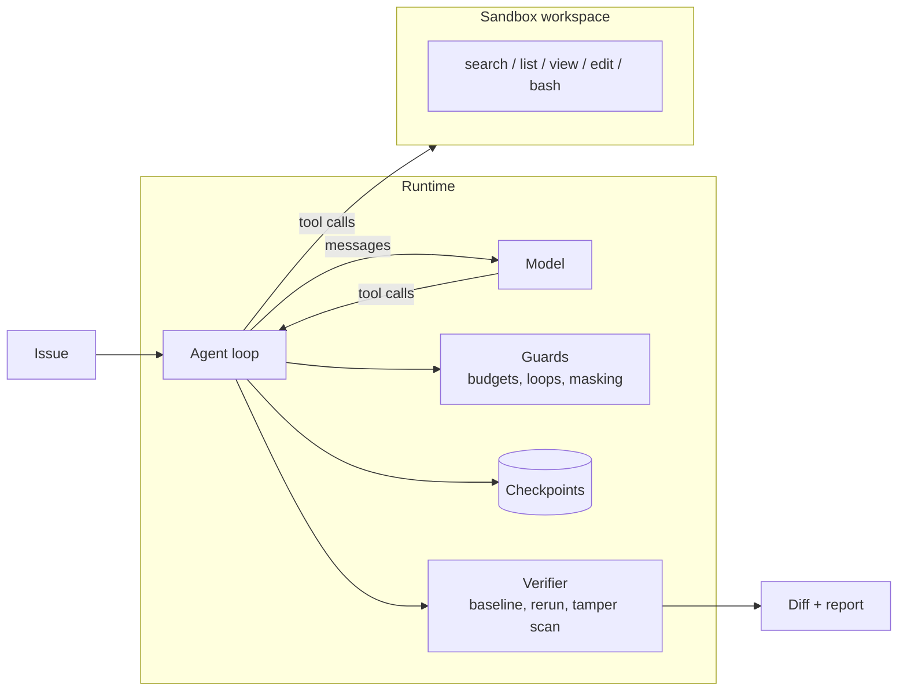

# issue-to-pr-agent

A small coding agent that takes an issue and returns a verified patch, built to show the parts of agent engineering that tutorials skip. The loop itself fits on one screen. Everything else in this repo exists to make that loop stop on time, stay inside its context budget, refuse to be fooled, and survive a crash.

```
issue ──► baseline tests ──► loop( model ► tools ► guards ► checkpoint ) ──► independent verification ──► diff + report
```

## Why this exists

Asking a model for a diff fails in four predictable ways. It edits the wrong place, nothing runs the code, it ignores the repo's conventions, and it gets one shot. An agent fixes those by exploring, running and iterating, and in doing so creates four new problems.

| Problem | What goes wrong | What this repo does about it |
| --- | --- | --- |
| Control | Loops forever, burns money | Step, time and cost budgets. Repetition detector. Budget warning. Explicit give-up path |
| Context | Window fills with stale logs, quality drops | Capped tool outputs. Old observations masked. Stable prefix for prompt caching |
| Verification | "Tests pass" by weakening tests, or claims success with no evidence | Baseline run, finish gated on a fresh test run, runtime re-verifies, diff scanned for tampering |
| Safety | Model-chosen shell commands, untrusted issue text | Workspace copy, scrubbed environment, path confinement, risk-tiered command policy |

## Architecture



| Module | Responsibility |
| --- | --- |
| `agent.py` | The loop, finish gating, verification hand-off, checkpoint writes, resume |
| `tools.py` | Six tools designed for a model. Capped, numbered output. Exact-match edits. Errors that say how to recover |
| `sandbox.py` | Throwaway workspace copy, scrubbed env, path confinement, timeouts, tail truncation, git-backed diff |
| `policy.py` | Command tiers. Free, needs approval, blocked |
| `guards.py` | Budget tracker, repetition detector, observation masking |
| `verify.py` | Pytest parsing, baseline comparison, test-tamper scanner |
| `checkpoint.py` | Atomic per-step checkpoints of messages plus workspace diff |
| `llm.py` | Anthropic adapter with prompt-cache breakpoints, and a scripted model for offline tests |
| `evals.py` | SWE-bench-shaped harness with hidden tests |

## Quickstart

```bash
pip install -e ".[dev]"
pytest                      # 56 tests, no API key needed
codeagent eval              # replays scripted oracle runs on the 3 bundled tasks

pip install -e ".[anthropic]"
export ANTHROPIC_API_KEY=...
codeagent eval --model claude-sonnet-5-5
codeagent run --repo path/to/repo --issue "CSV export breaks on commas" --approve
```

`--approve` prompts before risky commands. Without it, anything risky is denied and the agent is told why.

## Design decisions

**Tools are an interface for a model.** `view_file` returns numbered lines and says how many remain. `search_code` caps hits and tells the agent to narrow. `edit_file` requires an exact, unique match, so an edit made from a stale view fails loudly instead of corrupting the file, and the error points at the closest matching line.

**Stopping is designed, not hoped for.** Budgets on steps, wall-clock time and USD. The repetition detector hashes tool, input and result, so rerunning tests after a real edit counts as progress but the same failing call three times triggers a warning and a fourth stops the run. At 75% of the step budget the agent is told how many steps remain.

**Context is a managed resource.** Old tool results beyond the most recent six are replaced with a one-line placeholder. The agent can always re-view. The system prompt and tool definitions never change mid-run, so the prompt cache prefix stays valid. With the illustrative prices in `models.Pricing`, caching turns a USD 4.50 run into roughly USD 1.10 (there is a test for that arithmetic).

**The runtime trusts nothing the agent says.**
1. Tests run before the agent touches anything. Pre-existing failures are recorded and shown to the agent.
2. `finish(status="done")` is refused if any file changed since the last test run.
3. After finish, the runtime reruns the suite itself. Any test that passed at baseline and fails now marks the run failed.
4. "Done" with no changed files is a failure.
5. The diff is scanned for removed assertions, added skips, deleted test files and broad exception handlers. Findings go in the report for reviewers.

**Untrusted text stays data.** The issue is wrapped in tags and labelled as untrusted. Commands that pipe downloads into a shell, push, dump the environment or open remote shells are blocked. Network access and package installs need approval. The environment passed to commands contains no API keys or cloud credentials.

**Crashes resume.** After every step the runtime writes the conversation and the workspace diff atomically. `resume_run_id` rebuilds a fresh workspace, applies the diff and continues from the next step. The test suite simulates a crash at step 6 and checks the resumed run finishes with the same result.

## Evaluation

Each task in `evals/tasks/` has a repo, an issue, and hidden tests the agent never sees. A run is resolved only if the agent finished, the hidden tests pass, and nothing that passed at baseline now fails. That mirrors SWE-bench's fail-to-pass and pass-to-pass checks.

Scripted oracle runs (proves the harness and runtime, not a model)

```
task         resolved  stop                 steps     cost   hidden  tamper
csv_comma    True      finished                 9   0.0354   3/3      False
pagination   True      finished                 6   0.0236   4/4      False
slugify      True      finished                 5   0.0197   4/4      False
```

The `csv_comma` task deliberately ships with an unrelated failing test, so a correct run must leave it alone. The hidden tests include a plain-row byte-for-byte check, which catches the tempting "quote every field" partial fix (there is a test for that too).

Real-model numbers are not reported here yet. Three tasks is a smoke test, not a benchmark. Next step is mining 50 tasks from merged PRs in real repos.

## Limitations, stated plainly

- **The local sandbox is not a security boundary.** Commands run as your user. The scrubbed environment and policy reduce accidents, they do not stop a determined attacker. Run untrusted issues inside a container or microVM with networking off.
- Python and pytest only. The verifier parses pytest output.
- No PR publishing. The output is a diff and a report.
- The tamper scanner uses patterns. It catches common reward hacks, not clever ones. Treat findings as review flags.
- Policy patterns are a speed bump and an audit signal. The real control is what the sandbox can reach.

## Roadmap

| Phase | Adds |
| --- | --- |
| 1 (this repo) | Loop, tools, guards, verification, checkpoints, eval harness |
| 2 | Docker backend with `--network none` and resource limits behind the same sandbox interface |
| 3 | GitHub integration. Issue in, draft PR out, publisher outside the sandbox holds the token |
| 4 | Exploration subagent, independent reviewer pass, compaction for long runs |
| 5 | 50-task internal eval mined from merged PRs, cost per resolved task tracked per release |

## Layout

```
src/codeagent/   agent, tools, sandbox, policy, guards, verify, checkpoint, llm, evals, oracles, cli
evals/tasks/     csv_comma, pagination, slugify (repo, task.json, hidden tests)
tests/           56 tests covering tools, sandbox, guards, verification, agent behavior, adapter, evals
```

## License

MIT
